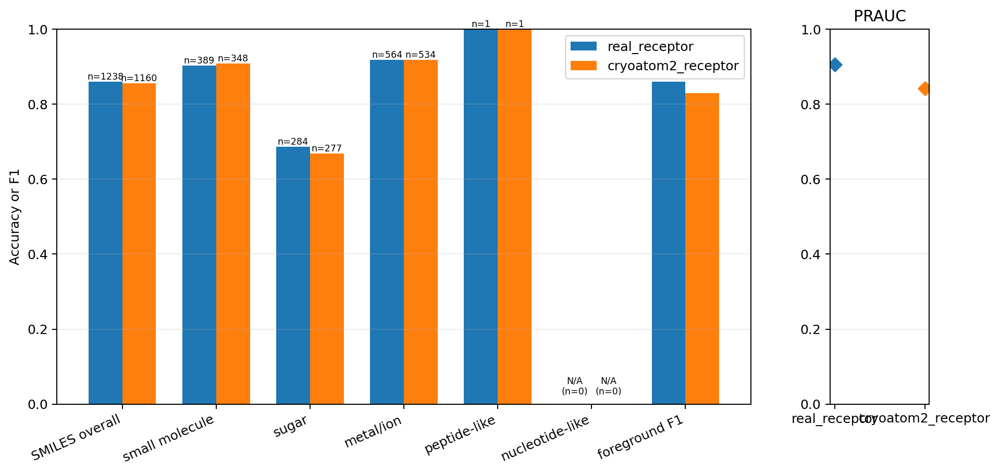
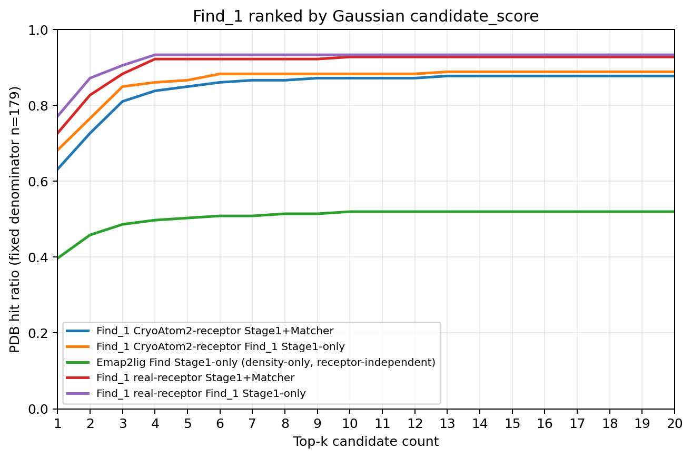
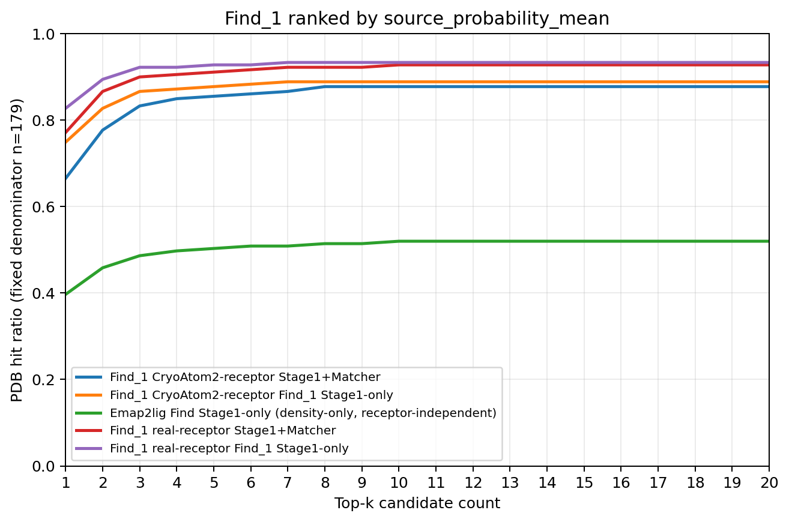

# 实验结果：blob_only-0

## 实验身份

| 字段 | 内容 |
| --- | --- |
| 实验标识 | `blob_only-0` |
| 正式模型变体 | `blob_only` |
| 一句话定义 | 候选侧只使用 V/blob token、V 的 count/mean/max 和四项裁剪统计；身份侧保留 SMI-TED、SMILES 图和同一 PDB 内身份清单。 |

本文件只记录冻结的正式结果。整理过程没有重新训练、重新前向、读取 calibration 或在测试集拟合阈值。

## 完整 held_out_test_0（179 PDB）

测试前向覆盖清单中的全部 centered 候选；前景与 SMILES 汇总指标只统计 `candidate_selected=True` 候选。真实受体条件前向 2,251 个候选，其中 1,653 个为 selected 候选；CryoAtom2 条件前向 2,407 个候选，其中 1,651 个为 selected 候选。

### 真实受体条件

| 指标 | 结果 |
| --- | ---: |
| PDB 数 | 179 |
| 全部 centered 候选数 | 2,251 |
| selected 候选数 | 1,653 |
| 前景 PRAUC | 0.9058347550370631 |
| 冻结 validation 阈值 | 0.30859375 |
| 固定阈值下的前景 F1 | 0.8598260869565217 |
| SMILES 总体匹配准确率 | 0.8602584814216478（1,065/1,238） |
| 不受支持身份候选数 | 2 |

| 真值类别 | SMILES 匹配准确率 | 正确数/支持数 |
| --- | ---: | ---: |
| `small_molecule` | 0.9023136246786633 | 351/389 |
| `sugar` | 0.6866197183098591 | 195/284 |
| `ion` | 0.9184397163120568 | 518/564 |
| `peptide_like` | 1.0 | 1/1 |
| `nucleotide_like` | 不适用 | 0/0 |

### CryoAtom2 条件

| 指标 | 结果 |
| --- | ---: |
| PDB 数 | 179 |
| 全部 centered 候选数 | 2,407 |
| selected 候选数 | 1,651 |
| 前景 PRAUC | 0.841844220551017 |
| 冻结 validation 阈值 | 0.30859375 |
| 固定阈值下的前景 F1 | 0.8293208767517067 |
| SMILES 总体匹配准确率 | 0.8551724137931035（992/1,160） |
| 不受支持身份候选数 | 2 |

| 真值类别 | SMILES 匹配准确率 | 正确数/支持数 |
| --- | ---: | ---: |
| `small_molecule` | 0.9080459770114943 | 316/348 |
| `sugar` | 0.6678700361010831 | 185/277 |
| `ion` | 0.9176029962546817 | 490/534 |
| `peptide_like` | 1.0 | 1/1 |
| `nucleotide_like` | 不适用 | 0/0 |

两个受体条件各有 2 个真实前景候选的目标身份不受严格 SMILES 图与 SMI-TED 资产支持，涉及 `9ian` 和 `9oq7`。这些候选保留原 Stage1 排名并进入前景评价，但退出 SMILES 匹配准确率分母；它们不能构成 Stage1+Matcher 的 SMILES 命中，也不会被删除后由后一名补位。

### Gaussian 排序下的 top-k

每个 PDB 先排列 selected 候选，再追加 unselected 候选；两段内部均按 `candidate_score` 降序排列。Stage1-only 与 Stage1+Matcher 使用同一候选顺序，分母固定为 179 个 PDB。

| k | 真实受体 Stage1-only | 真实受体 Stage1+Matcher | CryoAtom2 Stage1-only | CryoAtom2 Stage1+Matcher | Emap2lig Stage1-only |
| ---: | ---: | ---: | ---: | ---: | ---: |
| 1 | 138/179 | 130/179 | 122/179 | 113/179 | 71/179 |
| 3 | 162/179 | 158/179 | 152/179 | 145/179 | 87/179 |
| 5 | 167/179 | 165/179 | 155/179 | 152/179 | 90/179 |
| 10 | 167/179 | 166/179 | 158/179 | 156/179 | 93/179 |
| 20 | 167/179 | 166/179 | 159/179 | 157/179 | 93/179 |

### source_probability_mean 排序下的 top-k

候选集合与 selected 优先规则不变，只把两段内部排序分数改为 `source_probability_mean`。Emap2lig 使用实例内原生 ligand probability 均值，因此两张全测试集 top-k 图中的 Emap2lig 曲线逐项相同。

| k | 真实受体 Stage1-only | 真实受体 Stage1+Matcher | CryoAtom2 Stage1-only | CryoAtom2 Stage1+Matcher | Emap2lig Stage1-only |
| ---: | ---: | ---: | ---: | ---: | ---: |
| 1 | 148/179 | 138/179 | 134/179 | 119/179 | 71/179 |
| 3 | 165/179 | 161/179 | 155/179 | 149/179 | 87/179 |
| 5 | 166/179 | 163/179 | 157/179 | 153/179 | 90/179 |
| 10 | 167/179 | 166/179 | 159/179 | 157/179 | 93/179 |
| 20 | 167/179 | 166/179 | 159/179 | 157/179 | 93/179 |

Emap2lig 是单条 receptor-independent、density-only 的 Stage1-only 基线。它不具备 Matcher 的前景判断或 SMILES 身份匹配功能，且候选生成方式不同，不能把曲线差异单独归因于受体条件或 Matcher。

## 官方 test_1（149 PDB）

test_1 没有执行第二次前向。以下结果从同一次 held_out_test_0 冻结前向中按官方 149-PDB 列表筛选得到。

### 真实受体条件

| 指标 | 结果 |
| --- | ---: |
| selected 候选数 | 1,226 |
| 前景 PRAUC | 0.9273817164621746 |
| 固定阈值下的前景 F1 | 0.8582159624413146 |
| SMILES 总体匹配准确率 | 0.8601092896174863（787/915） |
| 不受支持身份候选数 | 2 |

| 真值类别 | SMILES 匹配准确率 | 正确数/支持数 |
| --- | ---: | ---: |
| `small_molecule` | 0.900804289544236 | 336/373 |
| `sugar` | 0.6845878136200717 | 191/279 |
| `ion` | 0.9885931558935361 | 260/263 |
| `peptide_like` | 不适用 | 0/0 |
| `nucleotide_like` | 不适用 | 0/0 |

### CryoAtom2 条件

| 指标 | 结果 |
| --- | ---: |
| selected 候选数 | 1,200 |
| 前景 PRAUC | 0.869127916157513 |
| 固定阈值下的前景 F1 | 0.8236462990561351 |
| SMILES 总体匹配准确率 | 0.8481927710843373（704/830） |
| 不受支持身份候选数 | 2 |

| 真值类别 | SMILES 匹配准确率 | 正确数/支持数 |
| --- | ---: | ---: |
| `small_molecule` | 0.9044776119402985 | 303/335 |
| `sugar` | 0.6388888888888888 | 161/252 |
| `ion` | 0.9876543209876543 | 240/243 |
| `peptide_like` | 不适用 | 0/0 |
| `nucleotide_like` | 不适用 | 0/0 |

## Stage3 小分子专用测试集

本节使用冻结的 `test_smallmolecule_v1` 清单，分母固定为 77 个 PDB。清单包含 446 个 Stage3 occurrence、104 个 Stage3 精确 SMILES 身份；Matcher 前向仍接收相应 PDB 的完整身份集合。Stage1+Stage2 不读取前景头或 validation 阈值，只检查身份 logits 是否命中唯一目标 SMILES。`blob_only-0` 的全配体答案范围与 small-molecule 答案范围逐点相同，因此下表只列一组 Stage1+Stage2 数值。

候选顺序先放 selected、再放 unselected；段内分别按 Gaussian `candidate_score` 或 `source_probability_mean` 降序排列。背景候选消耗尝试；唯一配对到非 Stage3 occurrence 的前景候选免费跳过；唯一配对到 Stage3 occurrence 的候选消耗尝试。

| k | 真实受体 Gaussian Stage1-only | 真实受体 Gaussian Stage1+Stage2 | CryoAtom2 Gaussian Stage1-only | CryoAtom2 Gaussian Stage1+Stage2 | 真实受体概率均值 Stage1-only | 真实受体概率均值 Stage1+Stage2 | CryoAtom2 概率均值 Stage1-only | CryoAtom2 概率均值 Stage1+Stage2 | Emap2lig 原生概率均值 |
| ---: | ---: | ---: | ---: | ---: | ---: | ---: | ---: | ---: | ---: |
| 1 | 63/77 | 59/77 | 49/77 | 45/77 | 64/77 | 59/77 | 57/77 | 50/77 | 45/77 |
| 2 | 66/77 | 61/77 | 54/77 | 50/77 | 66/77 | 60/77 | 62/77 | 56/77 | 49/77 |
| 3 | 67/77 | 62/77 | 62/77 | 57/77 | 66/77 | 62/77 | 66/77 | 61/77 | 50/77 |
| 4 | 68/77 | 63/77 | 64/77 | 58/77 | 67/77 | 62/77 | 67/77 | 61/77 | 52/77 |
| 5 | 69/77 | 63/77 | 66/77 | 59/77 | 68/77 | 62/77 | 68/77 | 61/77 | 53/77 |
| 6 | 69/77 | 63/77 | 68/77 | 61/77 | 68/77 | 62/77 | 68/77 | 61/77 | 54/77 |
| 7 | 69/77 | 63/77 | 68/77 | 61/77 | 69/77 | 63/77 | 68/77 | 61/77 | 54/77 |
| 8 | 69/77 | 63/77 | 68/77 | 62/77 | 69/77 | 63/77 | 68/77 | 62/77 | 54/77 |
| 9 | 69/77 | 64/77 | 68/77 | 62/77 | 69/77 | 64/77 | 68/77 | 62/77 | 54/77 |
| 10–20 | 69/77 | 64/77 | 68/77 | 62/77 | 69/77 | 64/77 | 68/77 | 62/77 | 54/77 |

### 小分子测试正式可视化

测试集图片/topk_gaussian_stage1_only.png>)

测试集图片/topk_probability_mean_stage1_only.png>)

测试集图片/topk_gaussian_stage1_stage2.png>)

测试集图片/topk_probability_mean_stage1_stage2.png>)

## 正式可视化

### 前景与 SMILES 指标

该图汇总 held_out_test_0 的 selected 候选前景指标、真实前景且身份受支持候选上的 SMILES 匹配准确率及支持数。前景 F1 使用 validation 冻结阈值。

### Gaussian 扩展 top-k

该图按 `candidate_score` 排序，采用 selected 候选优先、unselected 候选追加的唯一顺序；所有曲线的 PDB 分母固定为 179。

### 来源概率均值扩展 top-k

该图按 `source_probability_mean` 排序，候选集合、selected 优先规则和 179-PDB 分母与 Gaussian 图相同。

