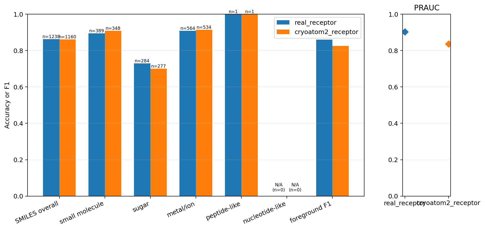
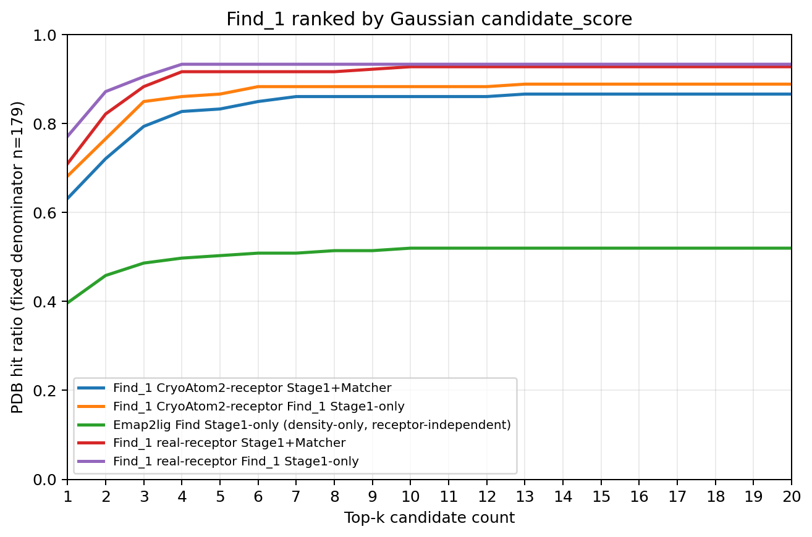
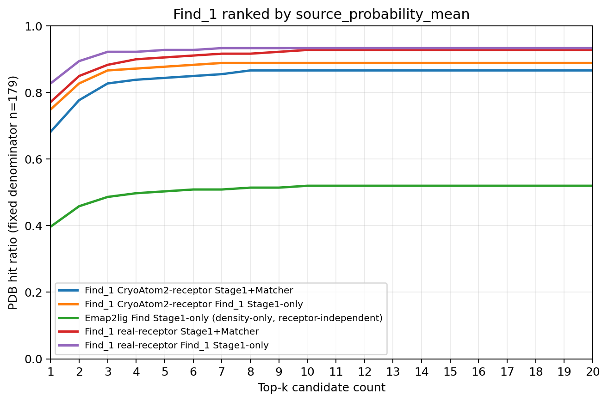

# 实验结果：dense_blob_only-0

## 实验身份

| 字段 | 内容 |
| --- | --- |
| 实验标识 | `dense_blob_only-0` |
| 正式模型变体 | `density_blob_only` |
| 一句话定义 | 仅用单通道实验密度驱动 U-Net，并保留 V/blob 候选 token、候选统计量和完整 SMILES 身份侧输入的正式消融变体。 |

本文件只整理已经冻结的正式测试产物。它不重新训练模型、不重新执行前向、不读取 calibration，也不在测试集重新拟合前景阈值。

## 完整 held_out_test_0（179 PDB）

测试前向覆盖清单中的全部 centered 候选；前景和 SMILES 汇总指标只统计 `candidate_selected=True` 候选。真实受体条件共前向 2,251 个候选，其中 1,653 个为 selected 候选；CryoAtom2 条件共前向 2,407 个候选，其中 1,651 个为 selected 候选。

### 真实受体条件

| 指标 | 结果 |
| --- | ---: |
| PDB 数 | 179 |
| 全部 centered 候选数 | 2,251 |
| selected 候选数 | 1,653 |
| 前景 PRAUC | 0.9028440725175563 |
| 冻结 validation 阈值 | 0.248046875 |
| 固定阈值下的前景 F1 | 0.85995085995086 |
| SMILES 总体匹配准确率 | 0.8626817447495961（1,068/1,238） |
| 不受支持身份候选数 | 2 |

| 真值类别 | SMILES 匹配准确率 | 正确数/支持数 |
| --- | ---: | ---: |
| `small_molecule` | 0.8946015424164524 | 348/389 |
| `sugar` | 0.7288732394366197 | 207/284 |
| `ion` | 0.9078014184397163 | 512/564 |
| `peptide_like` | 1.0 | 1/1 |
| `nucleotide_like` | 不适用 | 0/0 |

### CryoAtom2 条件

| 指标 | 结果 |
| --- | ---: |
| PDB 数 | 179 |
| 全部 centered 候选数 | 2,407 |
| selected 候选数 | 1,651 |
| 前景 PRAUC | 0.8365511548013763 |
| 冻结 validation 阈值 | 0.248046875 |
| 固定阈值下的前景 F1 | 0.8254665203073546 |
| SMILES 总体匹配准确率 | 0.8612068965517241（999/1,160） |
| 不受支持身份候选数 | 2 |

| 真值类别 | SMILES 匹配准确率 | 正确数/支持数 |
| --- | ---: | ---: |
| `small_molecule` | 0.9080459770114943 | 316/348 |
| `sugar` | 0.7003610108303249 | 194/277 |
| `ion` | 0.9138576779026217 | 488/534 |
| `peptide_like` | 1.0 | 1/1 |
| `nucleotide_like` | 不适用 | 0/0 |

两个条件各有 2 个真实前景候选的目标身份不受当前严格 SMILES 图与 SMI-TED 资产支持。这些候选涉及 `9ian` 和 `9oq7`：它们保留原 Stage1 排名并进入前景评价，但从 SMILES 匹配准确率的分子和分母中排除；在 Stage1+Matcher top-k 中也不能构成 SMILES 命中，且不会删除后让后续候选补位。

### Gaussian 排序下的 top-k

每个 PDB 先排列全部 selected 候选，再追加全部 unselected 候选；两段内部均按 `candidate_score` 降序排列。Stage1-only 与 Stage1+Matcher 使用同一候选顺序，分母固定为 179 个 PDB。

| k | 真实受体 Stage1-only | 真实受体 Stage1+Matcher | CryoAtom2 Stage1-only | CryoAtom2 Stage1+Matcher | Emap2lig Stage1-only |
| ---: | ---: | ---: | ---: | ---: | ---: |
| 1 | 138/179 | 127/179 | 122/179 | 113/179 | 71/179 |
| 3 | 162/179 | 158/179 | 152/179 | 142/179 | 87/179 |
| 5 | 167/179 | 164/179 | 155/179 | 149/179 | 90/179 |
| 10 | 167/179 | 166/179 | 158/179 | 154/179 | 93/179 |
| 20 | 167/179 | 166/179 | 159/179 | 155/179 | 93/179 |

### source_probability_mean 排序下的 top-k

候选集合和 selected 优先规则不变，只把两段内部的排序分数改为 `source_probability_mean`。Emap2lig 使用实例内原生 ligand probability 均值排序，因此本表中的 Emap2lig 曲线与 Gaussian 图中的同名基线逐项相同。

| k | 真实受体 Stage1-only | 真实受体 Stage1+Matcher | CryoAtom2 Stage1-only | CryoAtom2 Stage1+Matcher | Emap2lig Stage1-only |
| ---: | ---: | ---: | ---: | ---: | ---: |
| 1 | 148/179 | 138/179 | 134/179 | 122/179 | 71/179 |
| 3 | 165/179 | 158/179 | 155/179 | 148/179 | 87/179 |
| 5 | 166/179 | 162/179 | 157/179 | 151/179 | 90/179 |
| 10 | 167/179 | 166/179 | 159/179 | 155/179 | 93/179 |
| 20 | 167/179 | 166/179 | 159/179 | 155/179 | 93/179 |

Emap2lig 是单条 receptor-independent、density-only 的 Stage1-only 基线。它不读取受体模型，因此没有“真实受体”和“CryoAtom2”两条副本；其候选生成方式也与 Find_1 不同，不能把曲线差异单独归因为受体条件或 Matcher。

## 官方 test_1（149 PDB）

test_1 没有执行第二次模型前向。以下结果从同一次 held_out_test_0 冻结前向中，按官方 149-PDB 列表筛选得到。

### 真实受体条件

| 指标 | 结果 |
| --- | ---: |
| selected 候选数 | 1,226 |
| 前景 PRAUC | 0.9266899798242212 |
| 固定阈值下的前景 F1 | 0.8574126534466477 |
| SMILES 总体匹配准确率 | 0.8612021857923498（788/915） |
| 不受支持身份候选数 | 2 |

| 真值类别 | SMILES 匹配准确率 | 正确数/支持数 |
| --- | ---: | ---: |
| `small_molecule` | 0.8927613941018767 | 333/373 |
| `sugar` | 0.7240143369175627 | 202/279 |
| `ion` | 0.9619771863117871 | 253/263 |
| `peptide_like` | 不适用 | 0/0 |
| `nucleotide_like` | 不适用 | 0/0 |

### CryoAtom2 条件

| 指标 | 结果 |
| --- | ---: |
| selected 候选数 | 1,200 |
| 前景 PRAUC | 0.8622134403306787 |
| 固定阈值下的前景 F1 | 0.8231155778894472 |
| SMILES 总体匹配准确率 | 0.8518072289156626（707/830） |
| 不受支持身份候选数 | 2 |

| 真值类别 | SMILES 匹配准确率 | 正确数/支持数 |
| --- | ---: | ---: |
| `small_molecule` | 0.9074626865671642 | 304/335 |
| `sugar` | 0.6706349206349206 | 169/252 |
| `ion` | 0.9629629629629629 | 234/243 |
| `peptide_like` | 不适用 | 0/0 |
| `nucleotide_like` | 不适用 | 0/0 |

## Stage3 小分子专用测试集

本节使用冻结的 `test_smallmolecule_v1` 清单。评测范围为 77 个至少包含一个 Stage3 合格 occurrence 的 PDB，共含 446 个 Stage3 occurrence、104 个 Stage3 精确 SMILES 身份；Matcher 前向仍接收相应 PDB 的完整 180 个身份，small-molecule 答案范围只在同一次前向产生的身份 logits 上屏蔽非小分子答案。

Stage1 候选先服从 selected 优先顺序，再按 Gaussian `candidate_score` 或 `source_probability_mean` 降序排列。背景候选消耗一次尝试；唯一配对到非 Stage3 occurrence 的前景候选不消耗尝试，也不运行身份判定；唯一配对到 Stage3 occurrence 的候选消耗一次尝试。唯一配对先要求候选覆盖率和 occurrence 覆盖率均不低于 0.30，再最大化两者几何平均，并在并列时选择较小的 `occurrence_id`。

Stage1+Stage2 只检查身份 logits 是否命中目标 SMILES，不读取 Matcher 前景头，也不使用冻结前景阈值。以下每个单元格均为“命中数/77（命中比例）”。

### Stage1-only

| k | 真实受体 Gaussian | CryoAtom2 Gaussian | 真实受体概率均值 | CryoAtom2 概率均值 | Emap2lig 原生概率均值 |
| ---: | ---: | ---: | ---: | ---: | ---: |
| 1 | 63/77 (0.818182) | 49/77 (0.636364) | 64/77 (0.831169) | 57/77 (0.740260) | 45/77 (0.584416) |
| 2 | 66/77 (0.857143) | 54/77 (0.701299) | 66/77 (0.857143) | 62/77 (0.805195) | 49/77 (0.636364) |
| 3 | 67/77 (0.870130) | 62/77 (0.805195) | 66/77 (0.857143) | 66/77 (0.857143) | 50/77 (0.649351) |
| 4 | 68/77 (0.883117) | 64/77 (0.831169) | 67/77 (0.870130) | 67/77 (0.870130) | 52/77 (0.675325) |
| 5 | 69/77 (0.896104) | 66/77 (0.857143) | 68/77 (0.883117) | 68/77 (0.883117) | 53/77 (0.688312) |
| 6 | 69/77 (0.896104) | 68/77 (0.883117) | 68/77 (0.883117) | 68/77 (0.883117) | 54/77 (0.701299) |
| 7 | 69/77 (0.896104) | 68/77 (0.883117) | 69/77 (0.896104) | 68/77 (0.883117) | 54/77 (0.701299) |
| 8 | 69/77 (0.896104) | 68/77 (0.883117) | 69/77 (0.896104) | 68/77 (0.883117) | 54/77 (0.701299) |
| 9 | 69/77 (0.896104) | 68/77 (0.883117) | 69/77 (0.896104) | 68/77 (0.883117) | 54/77 (0.701299) |
| 10 | 69/77 (0.896104) | 68/77 (0.883117) | 69/77 (0.896104) | 68/77 (0.883117) | 54/77 (0.701299) |
| 11 | 69/77 (0.896104) | 68/77 (0.883117) | 69/77 (0.896104) | 68/77 (0.883117) | 54/77 (0.701299) |
| 12 | 69/77 (0.896104) | 68/77 (0.883117) | 69/77 (0.896104) | 68/77 (0.883117) | 54/77 (0.701299) |
| 13 | 69/77 (0.896104) | 68/77 (0.883117) | 69/77 (0.896104) | 68/77 (0.883117) | 54/77 (0.701299) |
| 14 | 69/77 (0.896104) | 68/77 (0.883117) | 69/77 (0.896104) | 68/77 (0.883117) | 54/77 (0.701299) |
| 15 | 69/77 (0.896104) | 68/77 (0.883117) | 69/77 (0.896104) | 68/77 (0.883117) | 54/77 (0.701299) |
| 16 | 69/77 (0.896104) | 68/77 (0.883117) | 69/77 (0.896104) | 68/77 (0.883117) | 54/77 (0.701299) |
| 17 | 69/77 (0.896104) | 68/77 (0.883117) | 69/77 (0.896104) | 68/77 (0.883117) | 54/77 (0.701299) |
| 18 | 69/77 (0.896104) | 68/77 (0.883117) | 69/77 (0.896104) | 68/77 (0.883117) | 54/77 (0.701299) |
| 19 | 69/77 (0.896104) | 68/77 (0.883117) | 69/77 (0.896104) | 68/77 (0.883117) | 54/77 (0.701299) |
| 20 | 69/77 (0.896104) | 68/77 (0.883117) | 69/77 (0.896104) | 68/77 (0.883117) | 54/77 (0.701299) |

Emap2lig 是唯一一条 density-only、receptor-independent 的 Stage1-only 曲线，不复制成真实受体和 CryoAtom2 两条曲线。

### Stage1+Stage2 身份命中

本模型的全配体答案范围与 small-molecule 答案范围在全部四种条件、全部 k 上逐点相同，因此下表每个数值同时代表两种答案范围。

| k | 真实受体 Gaussian | CryoAtom2 Gaussian | 真实受体概率均值 | CryoAtom2 概率均值 |
| ---: | ---: | ---: | ---: | ---: |
| 1 | 59/77 (0.766234) | 45/77 (0.584416) | 58/77 (0.753247) | 52/77 (0.675325) |
| 2 | 60/77 (0.779221) | 51/77 (0.662338) | 60/77 (0.779221) | 58/77 (0.753247) |
| 3 | 62/77 (0.805195) | 58/77 (0.753247) | 62/77 (0.805195) | 62/77 (0.805195) |
| 4 | 63/77 (0.818182) | 59/77 (0.766234) | 62/77 (0.805195) | 62/77 (0.805195) |
| 5 | 63/77 (0.818182) | 60/77 (0.779221) | 62/77 (0.805195) | 62/77 (0.805195) |
| 6 | 63/77 (0.818182) | 62/77 (0.805195) | 62/77 (0.805195) | 62/77 (0.805195) |
| 7 | 63/77 (0.818182) | 62/77 (0.805195) | 63/77 (0.818182) | 62/77 (0.805195) |
| 8 | 63/77 (0.818182) | 62/77 (0.805195) | 63/77 (0.818182) | 62/77 (0.805195) |
| 9 | 64/77 (0.831169) | 62/77 (0.805195) | 64/77 (0.831169) | 62/77 (0.805195) |
| 10 | 64/77 (0.831169) | 62/77 (0.805195) | 64/77 (0.831169) | 62/77 (0.805195) |
| 11 | 64/77 (0.831169) | 62/77 (0.805195) | 64/77 (0.831169) | 62/77 (0.805195) |
| 12 | 64/77 (0.831169) | 62/77 (0.805195) | 64/77 (0.831169) | 62/77 (0.805195) |
| 13 | 64/77 (0.831169) | 62/77 (0.805195) | 64/77 (0.831169) | 62/77 (0.805195) |
| 14 | 64/77 (0.831169) | 62/77 (0.805195) | 64/77 (0.831169) | 62/77 (0.805195) |
| 15 | 64/77 (0.831169) | 62/77 (0.805195) | 64/77 (0.831169) | 62/77 (0.805195) |
| 16 | 64/77 (0.831169) | 62/77 (0.805195) | 64/77 (0.831169) | 62/77 (0.805195) |
| 17 | 64/77 (0.831169) | 62/77 (0.805195) | 64/77 (0.831169) | 62/77 (0.805195) |
| 18 | 64/77 (0.831169) | 62/77 (0.805195) | 64/77 (0.831169) | 62/77 (0.805195) |
| 19 | 64/77 (0.831169) | 62/77 (0.805195) | 64/77 (0.831169) | 62/77 (0.805195) |
| 20 | 64/77 (0.831169) | 62/77 (0.805195) | 64/77 (0.831169) | 62/77 (0.805195) |

### 小分子测试正式可视化

测试集图片/topk_gaussian_stage1_only.png>)

测试集图片/topk_probability_mean_stage1_only.png>)

测试集图片/topk_gaussian_stage1_stage2.png>)

测试集图片/topk_probability_mean_stage1_stage2.png>)

## 正式可视化

### 前景与 SMILES 指标

该图汇总 held_out_test_0 的 selected 候选前景指标、真实前景且身份受支持候选上的 SMILES 匹配准确率及相应支持数。前景 F1 使用 validation 冻结阈值，未在测试集重新拟合。

### Gaussian 扩展 top-k

该图按 `candidate_score` 排序，采用 selected 候选优先、unselected 候选追加的唯一顺序；所有曲线的 PDB 分母固定为 179。

### 来源概率均值扩展 top-k

该图按 `source_probability_mean` 排序，候选集合、selected 优先规则和 179-PDB 分母与 Gaussian 图相同。

