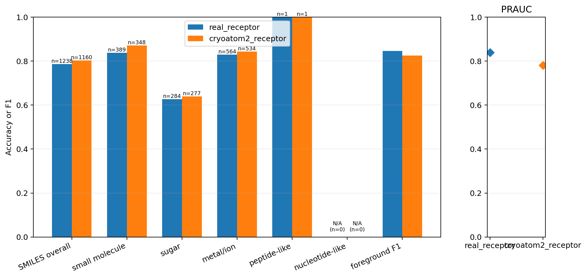
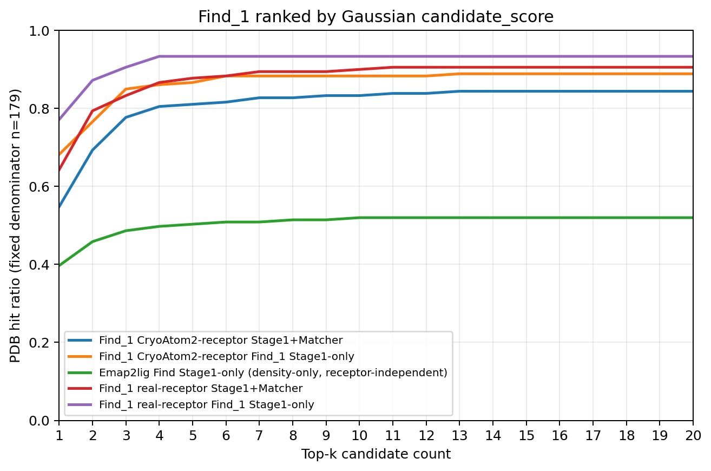
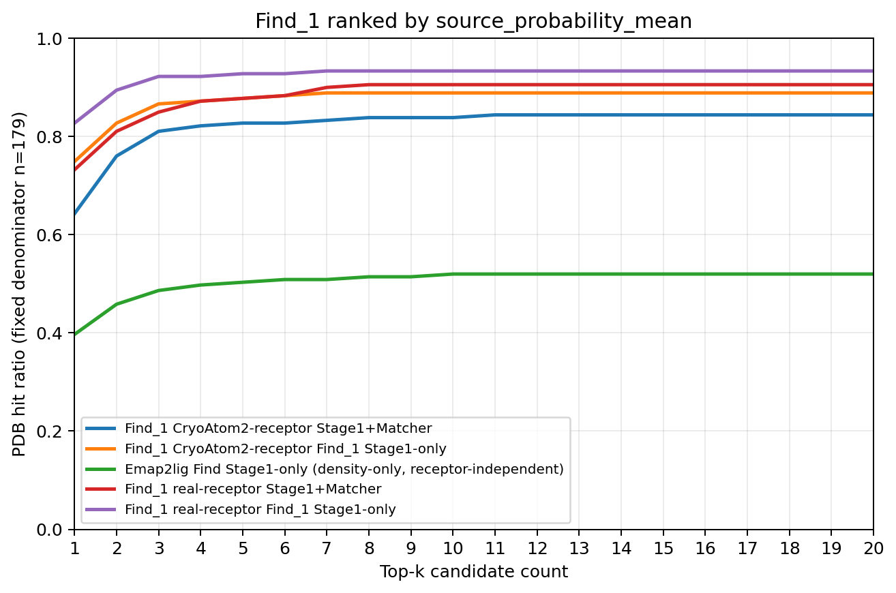

# 实验结果：density_only-0

## 实验身份

| 字段 | 内容 |
| --- | --- |
| 实验标识 | `density_only-0` |
| 正式模型变体 | `density_only` |
| 一句话定义 | 候选侧只使用按固定规则归一化的单通道实验密度，经 RAUNet 最高分辨率特征的空间 mean/max 形成候选表示；身份侧保留 SMI-TED、SMILES 图和同一 PDB 内身份清单。 |

本文件只记录冻结正式结果。整理过程没有重新训练、重新前向、读取 calibration 或在测试集拟合阈值。

## 完整 held_out_test_0（179 PDB）

测试前向覆盖全部 centered 候选；前景与 SMILES 汇总指标只统计 `candidate_selected=True` 候选。真实受体前向 2,251 个候选，其中 1,653 个为 selected；CryoAtom2 前向 2,407 个候选，其中 1,651 个为 selected。

### 真实受体条件

| 指标 | 结果 |
| --- | ---: |
| 前景 PRAUC | 0.8383943487615072 |
| 冻结 validation 阈值 | 0.52734375 |
| 固定阈值下的前景 F1 | 0.8457960644007155 |
| SMILES 总体匹配准确率 | 0.7859450726978998（973/1,238） |
| 不受支持身份候选数 | 2 |

| 真值类别 | SMILES 匹配准确率 | 正确数/支持数 |
| --- | ---: | ---: |
| `small_molecule` | 0.8380462724935732 | 326/389 |
| `sugar` | 0.6267605633802817 | 178/284 |
| `ion` | 0.8297872340425532 | 468/564 |
| `peptide_like` | 1.0 | 1/1 |
| `nucleotide_like` | 不适用 | 0/0 |

### CryoAtom2 条件

| 指标 | 结果 |
| --- | ---: |
| 前景 PRAUC | 0.7802365573046867 |
| 冻结 validation 阈值 | 0.52734375 |
| 固定阈值下的前景 F1 | 0.8244778307072188 |
| SMILES 总体匹配准确率 | 0.8025862068965517（931/1,160） |
| 不受支持身份候选数 | 2 |

| 真值类别 | SMILES 匹配准确率 | 正确数/支持数 |
| --- | ---: | ---: |
| `small_molecule` | 0.8706896551724138 | 303/348 |
| `sugar` | 0.6389891696750902 | 177/277 |
| `ion` | 0.8426966292134831 | 450/534 |
| `peptide_like` | 1.0 | 1/1 |
| `nucleotide_like` | 不适用 | 0/0 |

`9ian` 与 `9oq7` 各贡献一个不受支持身份目标。这些候选保留 Stage1 排名并参与前景评价，但退出 SMILES 准确率分母，不能构成 Stage1+Matcher 命中，也不会删除后让后一名补位。

### Gaussian 排序下的 top-k

每个 PDB 先排列 selected 候选，再追加 unselected 候选；两段内部按 `candidate_score` 降序。分母固定为 179，Matcher 不改变候选顺序。

| k | 真实受体 Stage1-only | 真实受体 Stage1+Matcher | CryoAtom2 Stage1-only | CryoAtom2 Stage1+Matcher | Emap2lig Stage1-only |
| ---: | ---: | ---: | ---: | ---: | ---: |
| 1 | 138/179 | 115/179 | 122/179 | 98/179 | 71/179 |
| 3 | 162/179 | 149/179 | 152/179 | 139/179 | 87/179 |
| 5 | 167/179 | 157/179 | 155/179 | 145/179 | 90/179 |
| 10 | 167/179 | 161/179 | 158/179 | 149/179 | 93/179 |
| 20 | 167/179 | 162/179 | 159/179 | 151/179 | 93/179 |

### source_probability_mean 排序下的 top-k

候选集合与 selected 优先规则不变，只把段内排序分数改为 `source_probability_mean`。Emap2lig 使用原生 ligand probability 均值，因此两张图中的单条 receptor-independent 曲线逐项相同。

| k | 真实受体 Stage1-only | 真实受体 Stage1+Matcher | CryoAtom2 Stage1-only | CryoAtom2 Stage1+Matcher | Emap2lig Stage1-only |
| ---: | ---: | ---: | ---: | ---: | ---: |
| 1 | 148/179 | 131/179 | 134/179 | 115/179 | 71/179 |
| 3 | 165/179 | 152/179 | 155/179 | 145/179 | 87/179 |
| 5 | 166/179 | 157/179 | 157/179 | 148/179 | 90/179 |
| 10 | 167/179 | 162/179 | 159/179 | 150/179 | 93/179 |
| 20 | 167/179 | 162/179 | 159/179 | 151/179 | 93/179 |

## 官方 test_1（149 PDB）

test_1 只复用同一次 test_0 冻结前向并按官方列表筛选，不进行第二次前向。

| 条件 | selected 候选 | PRAUC | 固定阈值 F1 | SMILES 总体准确率 | 不受支持身份 |
| --- | ---: | ---: | ---: | ---: | ---: |
| 真实受体 | 1,226 | 0.856923739389172 | 0.8418491484184915 | 0.7726775956284153（707/915） | 2 |
| CryoAtom2 | 1,200 | 0.7964047863637265 | 0.8181818181818182 | 0.7855421686746988（652/830） | 2 |

| 条件 | `small_molecule` | `sugar` | `ion` | `peptide_like` | `nucleotide_like` |
| --- | ---: | ---: | ---: | ---: | ---: |
| 真实受体 | 0.8337801608579088（311/373） | 0.6236559139784946（174/279） | 0.844106463878327（222/263） | 不适用 | 不适用 |
| CryoAtom2 | 0.8656716417910447（290/335） | 0.6071428571428571（153/252） | 0.8600823045267489（209/243） | 不适用 | 不适用 |

## Stage3 小分子专用测试集

分母固定为 77 个 PDB。Stage1+Stage2 忽略前景头和 validation 阈值，只检查身份 logits；候选顺序与完整测试一致。表中依次列出 k=1、3、5、10、20 的命中数。

| 排序与条件 | 全配体答案范围 | small-molecule 答案范围 |
| --- | --- | --- |
| Gaussian，真实受体 | 53、58、60、61、61 | 55、60、61、62、62 |
| Gaussian，CryoAtom2 | 39、53、57、59、60 | 43、57、59、61、62 |
| 概率均值，真实受体 | 51、58、59、61、61 | 55、59、60、62、62 |
| 概率均值，CryoAtom2 | 43、59、59、59、60 | 48、61、61、61、62 |

## 正式可视化

### 全测试集

### Stage3 小分子测试集

测试集图片/topk_gaussian_stage1_only.png>)

测试集图片/topk_probability_mean_stage1_only.png>)

测试集图片/topk_gaussian_stage1_stage2.png>)

测试集图片/topk_probability_mean_stage1_stage2.png>)
