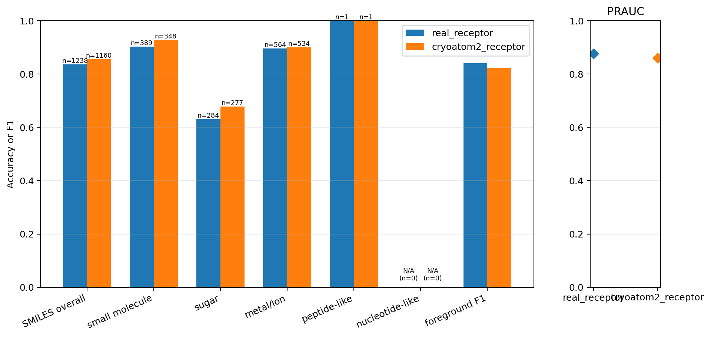
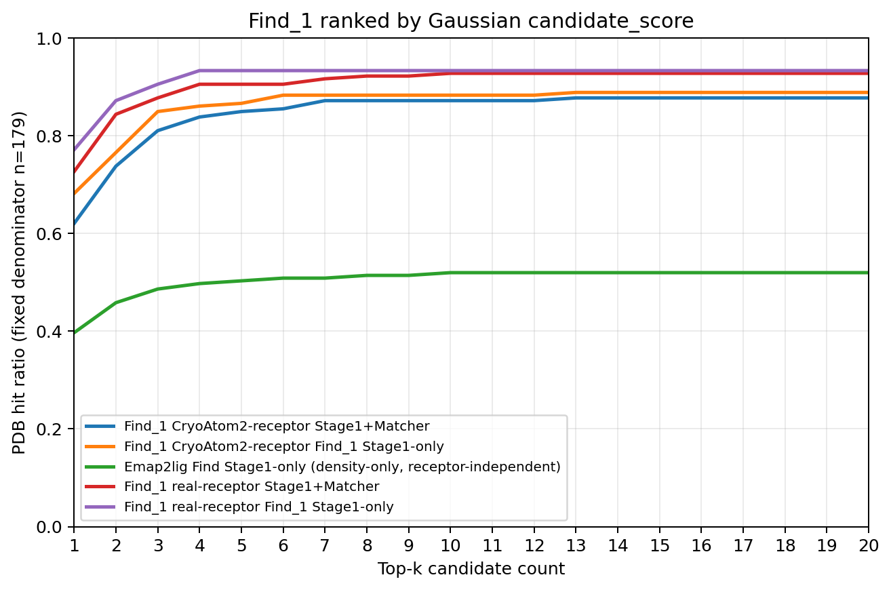
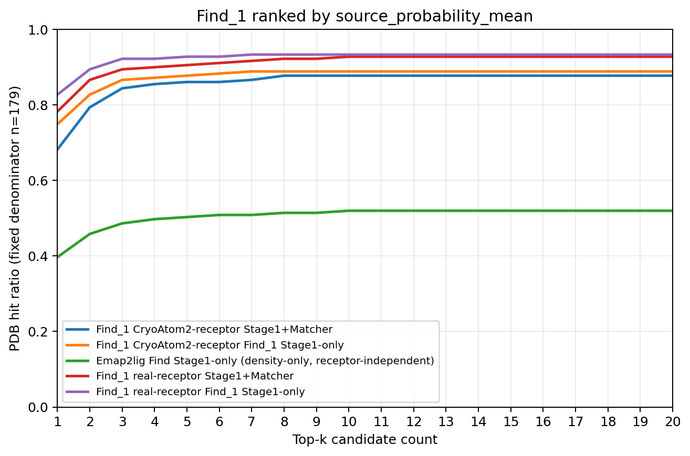

# 实验结果：density_only-106

## 实验身份

| 字段 | 内容 |
| --- | --- |
| 实验标识 | `density_only-106` |
| 正式模型变体 | `density_only_106` |
| 一句话定义 | 候选侧只使用 56 通道完整密度 bank 与 50 通道受体原子特征体素网格，经 RAUNet 最高分辨率特征的空间 mean/max 形成候选表示。 |

该模型应称为“106 通道体素-only”，不是纯密度模型。56 通道包含实验密度、模拟密度及受体掩码参与的派生通道。整理过程没有重新训练、重新前向、读取 calibration 或在测试集拟合阈值。

## 完整 held_out_test_0（179 PDB）

真实受体前向 2,251 个 centered 候选，其中 1,653 个为 selected；CryoAtom2 前向 2,407 个，其中 1,651 个为 selected。汇总指标只统计 selected 候选。

| 条件 | PRAUC | 固定阈值 F1 | SMILES 总体准确率 | 不受支持身份 |
| --- | ---: | ---: | ---: | ---: |
| 真实受体 | 0.8767019741015564 | 0.8409818569903948 | 0.8368336025848142（1,036/1,238） | 2 |
| CryoAtom2 | 0.8593642788461042 | 0.8219378427787934 | 0.8560344827586207（993/1,160） | 2 |

冻结 validation 前景阈值为 `0.396484375`。

| 条件 | `small_molecule` | `sugar` | `ion` | `peptide_like` | `nucleotide_like` |
| --- | ---: | ---: | ---: | ---: | ---: |
| 真实受体 | 0.9023136246786633（351/389） | 0.6302816901408451（179/284） | 0.8953900709219859（505/564） | 1.0（1/1） | 不适用 |
| CryoAtom2 | 0.9281609195402298（323/348） | 0.6787003610108303（188/277） | 0.900749063670412（481/534） | 1.0（1/1） | 不适用 |

`9ian` 与 `9oq7` 各贡献一个不受支持身份目标。这些候选参与前景评价并保留排名，但退出身份准确率分母，也不能构成 Stage1+Matcher 命中。

### Gaussian 排序下的 top-k

| k | 真实受体 Stage1-only | 真实受体 Stage1+Matcher | CryoAtom2 Stage1-only | CryoAtom2 Stage1+Matcher | Emap2lig Stage1-only |
| ---: | ---: | ---: | ---: | ---: | ---: |
| 1 | 138/179 | 130/179 | 122/179 | 111/179 | 71/179 |
| 3 | 162/179 | 157/179 | 152/179 | 145/179 | 87/179 |
| 5 | 167/179 | 162/179 | 155/179 | 152/179 | 90/179 |
| 10 | 167/179 | 166/179 | 158/179 | 156/179 | 93/179 |
| 20 | 167/179 | 166/179 | 159/179 | 157/179 | 93/179 |

### source_probability_mean 排序下的 top-k

| k | 真实受体 Stage1-only | 真实受体 Stage1+Matcher | CryoAtom2 Stage1-only | CryoAtom2 Stage1+Matcher | Emap2lig Stage1-only |
| ---: | ---: | ---: | ---: | ---: | ---: |
| 1 | 148/179 | 140/179 | 134/179 | 122/179 | 71/179 |
| 3 | 165/179 | 160/179 | 155/179 | 151/179 | 87/179 |
| 5 | 166/179 | 162/179 | 157/179 | 154/179 | 90/179 |
| 10 | 167/179 | 166/179 | 159/179 | 157/179 | 93/179 |
| 20 | 167/179 | 166/179 | 159/179 | 157/179 | 93/179 |

候选顺序始终先放 selected、再追加 unselected；段内分别按指定分数降序。Matcher 不改变顺序。Emap2lig 是单条 receptor-independent Stage1-only 基线。

## 官方 test_1（149 PDB）

test_1 只筛选同一次 test_0 冻结前向。

| 条件 | selected 候选 | PRAUC | 固定阈值 F1 | SMILES 总体准确率 | 不受支持身份 |
| --- | ---: | ---: | ---: | ---: | ---: |
| 真实受体 | 1,226 | 0.9072384338467722 | 0.8445078459343794 | 0.8382513661202186（767/915） | 2 |
| CryoAtom2 | 1,200 | 0.8941667960817612 | 0.8227021597187343 | 0.8566265060240964（711/830） | 2 |

| 条件 | `small_molecule` | `sugar` | `ion` | `peptide_like` | `nucleotide_like` |
| --- | ---: | ---: | ---: | ---: | ---: |
| 真实受体 | 0.903485254691689（337/373） | 0.6272401433691757（175/279） | 0.9695817490494296（255/263） | 不适用 | 不适用 |
| CryoAtom2 | 0.9283582089552239（311/335） | 0.6507936507936508（164/252） | 0.9711934156378601（236/243） | 不适用 | 不适用 |

## Stage3 小分子专用测试集

分母固定为 77 个 PDB；Stage1+Stage2 忽略前景头和阈值。各单元格依次为 k=1、3、5、10、20 的命中数。

| 排序与条件 | 全配体答案范围 | small-molecule 答案范围 |
| --- | --- | --- |
| Gaussian，真实受体 | 61、63、64、65、65 | 61、63、64、65、65 |
| Gaussian，CryoAtom2 | 46、59、61、64、64 | 47、60、62、65、65 |
| 概率均值，真实受体 | 60、63、63、65、65 | 60、63、63、65、65 |
| 概率均值，CryoAtom2 | 52、63、63、64、64 | 53、64、64、65、65 |

## 正式可视化

测试集图片/topk_gaussian_stage1_only.png>)

测试集图片/topk_probability_mean_stage1_only.png>)

测试集图片/topk_gaussian_stage1_stage2.png>)

测试集图片/topk_probability_mean_stage1_stage2.png>)
