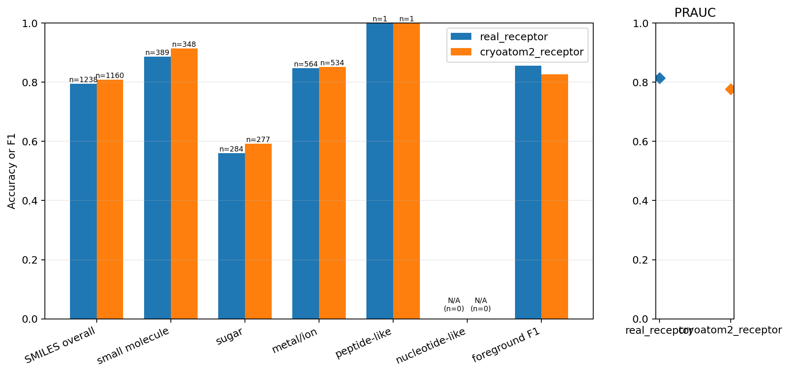
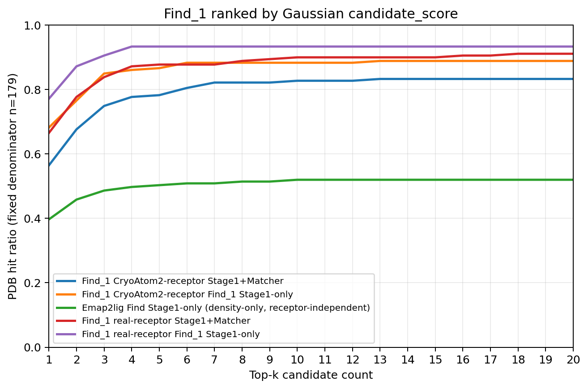
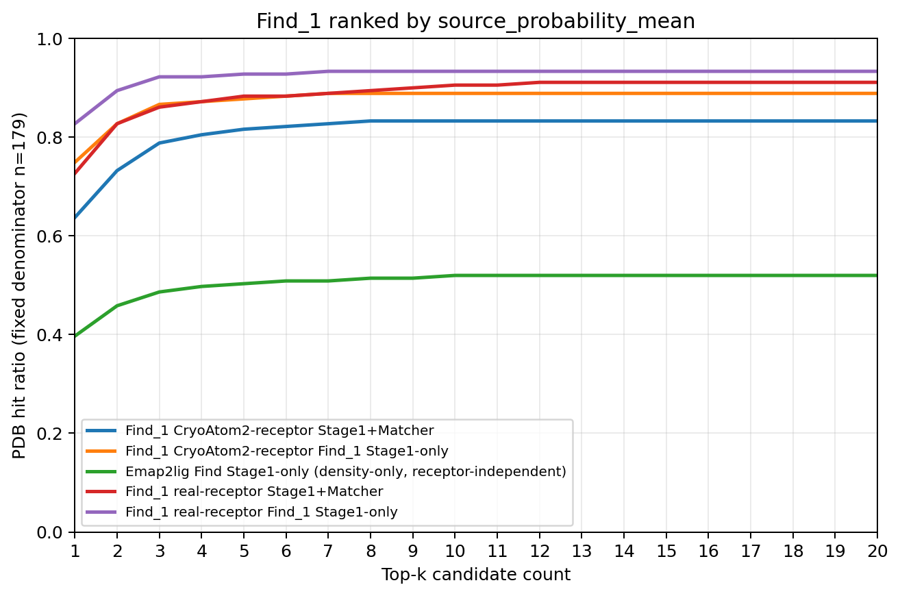

# 实验结果：pocket_only-0

## 实验身份

| 字段 | 内容 |
| --- | --- |
| 实验标识 | `pocket_only-0` |
| 正式模型变体 | `pocket_only` |
| 一句话定义 | 候选侧只读取原始 50 维 A_feat_L0，经 token 投影和掩码 mean/max 形成候选表示；不读取密度、V、P、PP 或候选人工统计。 |

身份侧与第二轮正式主线相同。模型不实例化 RAUNet、区域头、体素调制器或候选模态聚合器。整理过程没有重新训练、重新前向、读取 calibration 或在测试集拟合阈值。

## 完整 held_out_test_0（179 PDB）

真实受体前向 2,251 个 centered 候选，其中 1,653 个为 selected；CryoAtom2 前向 2,407 个，其中 1,651 个为 selected。汇总指标只统计 selected 候选。

| 条件 | PRAUC | 固定阈值 F1 | SMILES 总体准确率 | 不受支持身份 |
| --- | ---: | ---: | ---: | ---: |
| 真实受体 | 0.8141009536056185 | 0.8561176892716182 | 0.7940226171243941（983/1,238） | 2 |
| CryoAtom2 | 0.7760299316752725 | 0.8265381764269829 | 0.8086206896551724（938/1,160） | 2 |

冻结 validation 前景阈值为 `0.53515625`。

| 条件 | `small_molecule` | `sugar` | `ion` | `peptide_like` | `nucleotide_like` |
| --- | ---: | ---: | ---: | ---: | ---: |
| 真实受体 | 0.8868894601542416（345/389） | 0.5598591549295775（159/284） | 0.8475177304964538（478/564） | 1.0（1/1） | 不适用 |
| CryoAtom2 | 0.9137931034482759（318/348） | 0.592057761732852（164/277） | 0.8520599250936329（455/534） | 1.0（1/1） | 不适用 |

`9ian` 与 `9oq7` 各贡献一个不受支持身份目标。这些候选参与前景评价并保留排名，但退出身份准确率分母，也不能构成 Stage1+Matcher 命中。

### Gaussian 排序下的 top-k

| k | 真实受体 Stage1-only | 真实受体 Stage1+Matcher | CryoAtom2 Stage1-only | CryoAtom2 Stage1+Matcher | Emap2lig Stage1-only |
| ---: | ---: | ---: | ---: | ---: | ---: |
| 1 | 138/179 | 119/179 | 122/179 | 101/179 | 71/179 |
| 3 | 162/179 | 150/179 | 152/179 | 134/179 | 87/179 |
| 5 | 167/179 | 157/179 | 155/179 | 140/179 | 90/179 |
| 10 | 167/179 | 161/179 | 158/179 | 148/179 | 93/179 |
| 20 | 167/179 | 163/179 | 159/179 | 149/179 | 93/179 |

### source_probability_mean 排序下的 top-k

| k | 真实受体 Stage1-only | 真实受体 Stage1+Matcher | CryoAtom2 Stage1-only | CryoAtom2 Stage1+Matcher | Emap2lig Stage1-only |
| ---: | ---: | ---: | ---: | ---: | ---: |
| 1 | 148/179 | 130/179 | 134/179 | 114/179 | 71/179 |
| 3 | 165/179 | 154/179 | 155/179 | 141/179 | 87/179 |
| 5 | 166/179 | 158/179 | 157/179 | 146/179 | 90/179 |
| 10 | 167/179 | 162/179 | 159/179 | 149/179 | 93/179 |
| 20 | 167/179 | 163/179 | 159/179 | 149/179 | 93/179 |

候选顺序始终先放 selected、再追加 unselected；段内分别按指定分数降序。Matcher 不改变顺序。Emap2lig 是单条 receptor-independent Stage1-only 基线。

## 官方 test_1（149 PDB）

test_1 只筛选同一次 test_0 冻结前向。

| 条件 | selected 候选 | PRAUC | 固定阈值 F1 | SMILES 总体准确率 | 不受支持身份 |
| --- | ---: | ---: | ---: | ---: | ---: |
| 真实受体 | 1,226 | 0.8325506463893918 | 0.8554801163918526 | 0.7868852459016393（720/915） | 2 |
| CryoAtom2 | 1,200 | 0.8013917238539132 | 0.8211716341212744 | 0.7963855421686747（661/830） | 2 |

| 条件 | `small_molecule` | `sugar` | `ion` | `peptide_like` | `nucleotide_like` |
| --- | ---: | ---: | ---: | ---: | ---: |
| 真实受体 | 0.8873994638069705（331/373） | 0.5555555555555556（155/279） | 0.8897338403041825（234/263） | 不适用 | 不适用 |
| CryoAtom2 | 0.9104477611940298（305/335） | 0.5555555555555556（140/252） | 0.8888888888888888（216/243） | 不适用 | 不适用 |

## Stage3 小分子专用测试集

分母固定为 77 个 PDB；Stage1+Stage2 忽略前景头和阈值。各单元格依次为 k=1、3、5、10、20 的命中数。

| 排序与条件 | 全配体答案范围 | small-molecule 答案范围 |
| --- | --- | --- |
| Gaussian，真实受体 | 55、58、60、60、60 | 55、59、61、61、61 |
| Gaussian，CryoAtom2 | 40、52、54、56、56 | 41、54、56、58、58 |
| 概率均值，真实受体 | 56、58、59、60、60 | 57、59、60、61、61 |
| 概率均值，CryoAtom2 | 48、56、56、56、56 | 50、58、58、58、58 |

## 正式可视化

测试集图片/topk_gaussian_stage1_only.png>)

测试集图片/topk_probability_mean_stage1_only.png>)

测试集图片/topk_gaussian_stage1_stage2.png>)

测试集图片/topk_probability_mean_stage1_stage2.png>)
