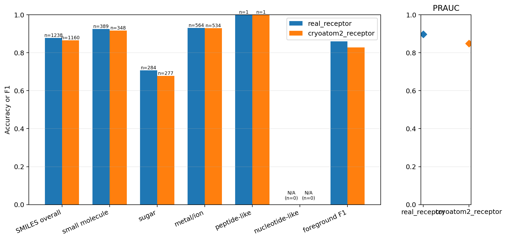
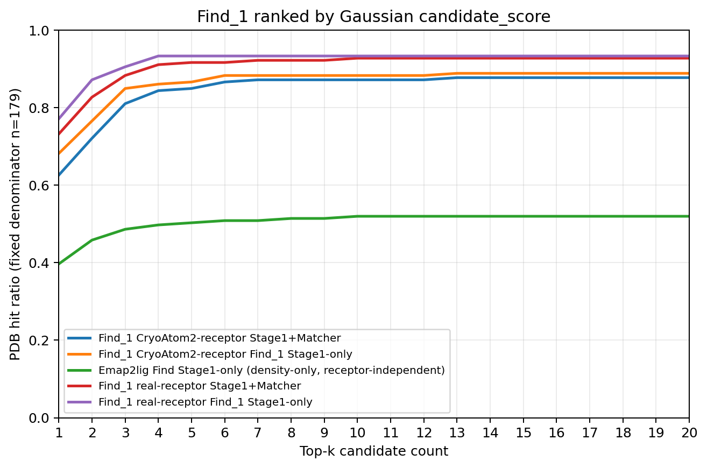
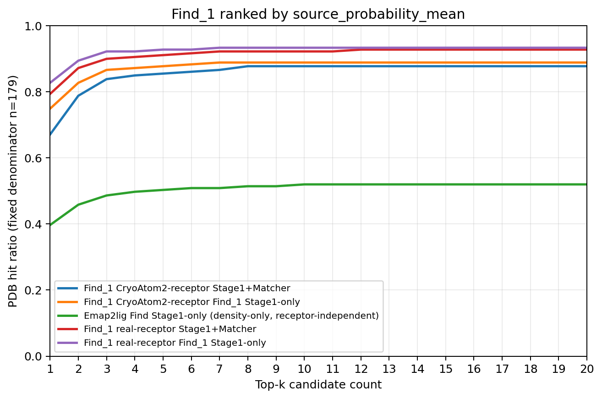

# 实验结果：strongest-1

## 实验身份

| 字段 | 内容 |
| --- | --- |
| 实验标识 | `strongest-1` |
| 正式模型变体 | `strongest` |
| 一句话定义 | 候选侧联合使用 106 通道体素、A/P/V/PP token 与候选统计；A、P、PP 各有一个初值为 0.01 的独立可学习门，RAUNet 不含末端多尺度卷积分支。 |

正式优化目标的四项损失权重为前景 `0.30`、ligand-area `0.00`、binding-area `0.00`、SMILES 身份 `1.00`。区域头仍属于模型结构，但不进入优化目标。本次整理没有重新训练、重新前向、读取 calibration 或在测试集拟合阈值。

## 完整 held_out_test_0（179 PDB）

真实受体前向 2,251 个 centered 候选，其中 1,653 个为 selected；CryoAtom2 前向 2,407 个，其中 1,651 个为 selected。汇总指标只统计 selected 候选。

| 条件 | PRAUC | 固定阈值 F1 | SMILES 总体准确率 | 不受支持身份 |
| --- | ---: | ---: | ---: | ---: |
| 真实受体 | 0.8968040577960534 | 0.8602836879432624 | 0.8780290791599353（1,087/1,238） | 2 |
| CryoAtom2 | 0.8480476709942253 | 0.8285291943828529 | 0.8655172413793103（1,004/1,160） | 2 |

冻结 validation 前景阈值为 `0.359375`。

| 条件 | `small_molecule` | `sugar` | `ion` | `peptide_like` | `nucleotide_like` |
| --- | ---: | ---: | ---: | ---: | ---: |
| 真实受体 | 0.9254498714652957（360/389） | 0.7077464788732394（201/284） | 0.9308510638297872（525/564） | 1.0（1/1） | 不适用 |
| CryoAtom2 | 0.9166666666666666（319/348） | 0.6787003610108303（188/277） | 0.9288389513108615（496/534） | 1.0（1/1） | 不适用 |

`9ian` 与 `9oq7` 各贡献一个不受支持身份目标。这些候选参与前景评价并保留排名，但退出身份准确率分母，也不能构成 Stage1+Matcher 命中。

### Gaussian 排序下的 top-k

| k | 真实受体 Stage1-only | 真实受体 Stage1+Matcher | CryoAtom2 Stage1-only | CryoAtom2 Stage1+Matcher | Emap2lig Stage1-only |
| ---: | ---: | ---: | ---: | ---: | ---: |
| 1 | 138/179 | 131/179 | 122/179 | 112/179 | 71/179 |
| 3 | 162/179 | 158/179 | 152/179 | 145/179 | 87/179 |
| 5 | 167/179 | 164/179 | 155/179 | 152/179 | 90/179 |
| 10 | 167/179 | 166/179 | 158/179 | 156/179 | 93/179 |
| 20 | 167/179 | 166/179 | 159/179 | 157/179 | 93/179 |

### source_probability_mean 排序下的 top-k

| k | 真实受体 Stage1-only | 真实受体 Stage1+Matcher | CryoAtom2 Stage1-only | CryoAtom2 Stage1+Matcher | Emap2lig Stage1-only |
| ---: | ---: | ---: | ---: | ---: | ---: |
| 1 | 148/179 | 142/179 | 134/179 | 120/179 | 71/179 |
| 3 | 165/179 | 161/179 | 155/179 | 150/179 | 87/179 |
| 5 | 166/179 | 163/179 | 157/179 | 153/179 | 90/179 |
| 10 | 167/179 | 165/179 | 159/179 | 157/179 | 93/179 |
| 20 | 167/179 | 166/179 | 159/179 | 157/179 | 93/179 |

候选顺序始终先放 selected、再追加 unselected；段内分别按指定分数降序。Matcher 不改变顺序。Emap2lig 是单条 receptor-independent Stage1-only 基线。

## 官方 test_1（149 PDB）

test_1 只筛选同一次 test_0 冻结前向。

| 条件 | selected 候选 | PRAUC | 固定阈值 F1 | SMILES 总体准确率 | 不受支持身份 |
| --- | ---: | ---: | ---: | ---: | ---: |
| 真实受体 | 1,226 | 0.9210499351684459 | 0.8604206500956023 | 0.8775956284153006（803/915） | 2 |
| CryoAtom2 | 1,200 | 0.8771155328309025 | 0.8246687054026504 | 0.8578313253012049（712/830） | 2 |

| 条件 | `small_molecule` | `sugar` | `ion` | `peptide_like` | `nucleotide_like` |
| --- | ---: | ---: | ---: | ---: | ---: |
| 真实受体 | 0.9276139410187667（346/373） | 0.7025089605734767（196/279） | 0.9923954372623575（261/263） | 不适用 | 不适用 |
| CryoAtom2 | 0.9164179104477612（307/335） | 0.6507936507936508（164/252） | 0.9917695473251029（241/243） | 不适用 | 不适用 |

## Stage3 小分子专用测试集

分母固定为 77 个 PDB；Stage1+Stage2 忽略前景头和阈值。各单元格依次为 k=1、3、5、10、20 的命中数。

| 排序与条件 | 全配体答案范围 | small-molecule 答案范围 |
| --- | --- | --- |
| Gaussian，真实受体 | 59、63、64、64、64 | 59、63、64、64、64 |
| Gaussian，CryoAtom2 | 45、59、61、63、63 | 45、59、61、63、63 |
| 概率均值，真实受体 | 61、63、63、64、64 | 61、63、63、64、64 |
| 概率均值，CryoAtom2 | 51、63、63、63、63 | 51、63、63、63、63 |

## 正式可视化

测试集图片/topk_gaussian_stage1_only.png>)

测试集图片/topk_probability_mean_stage1_only.png>)

测试集图片/topk_gaussian_stage1_stage2.png>)

测试集图片/topk_probability_mean_stage1_stage2.png>)
