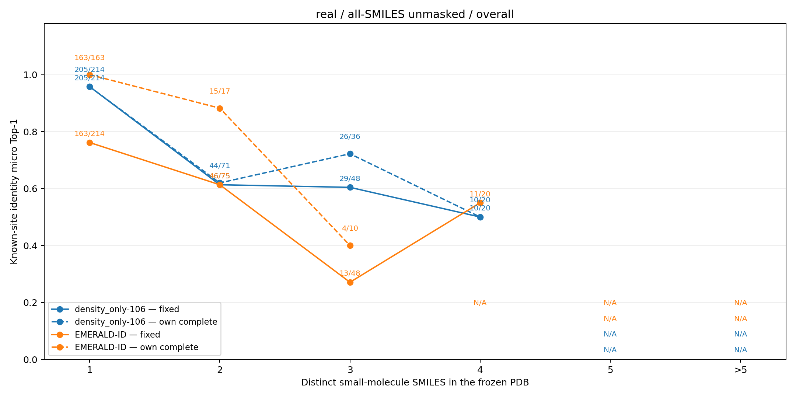
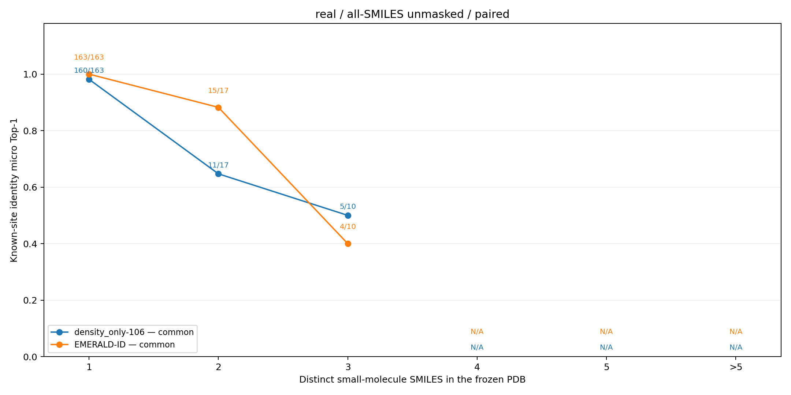
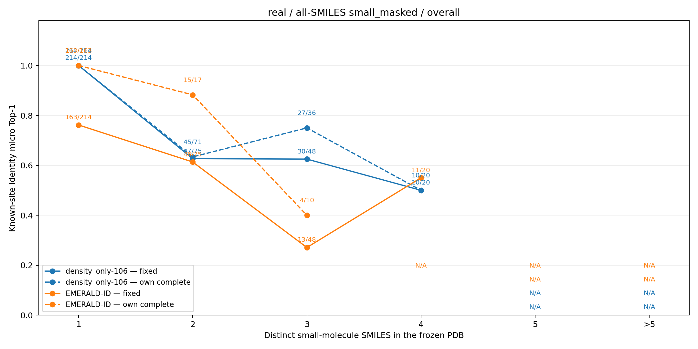
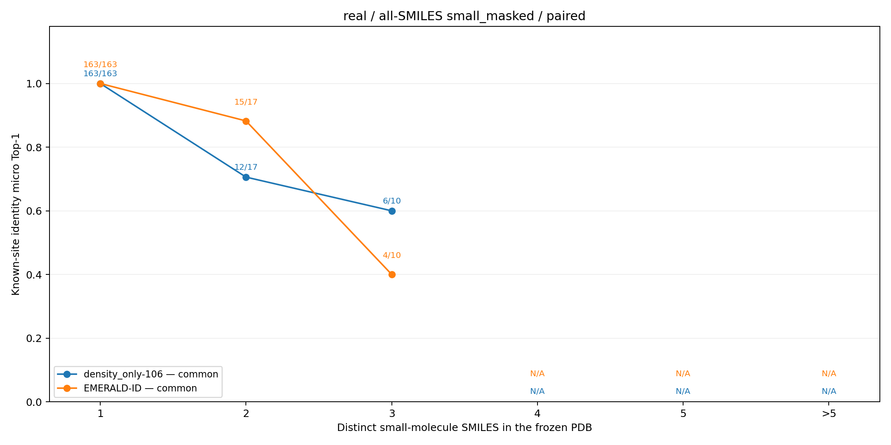
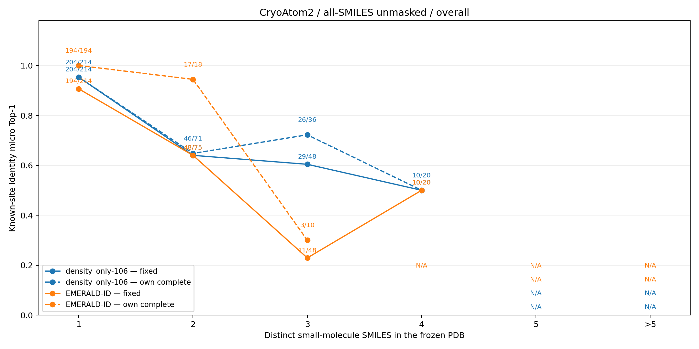
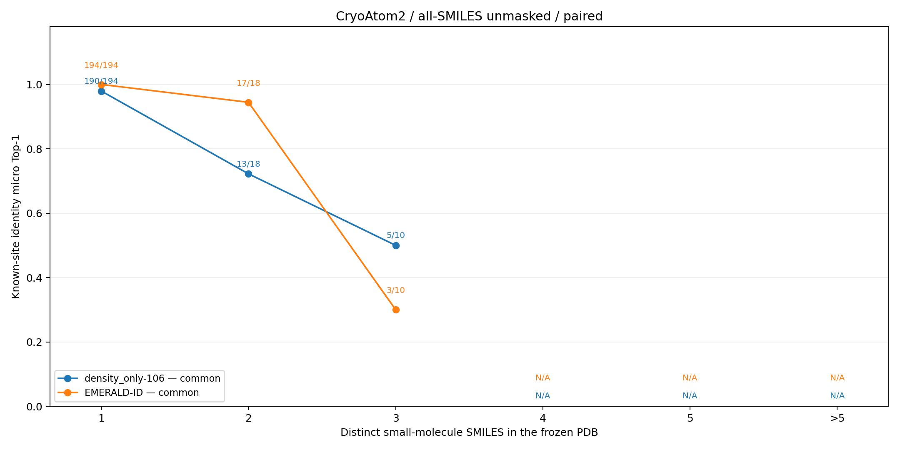
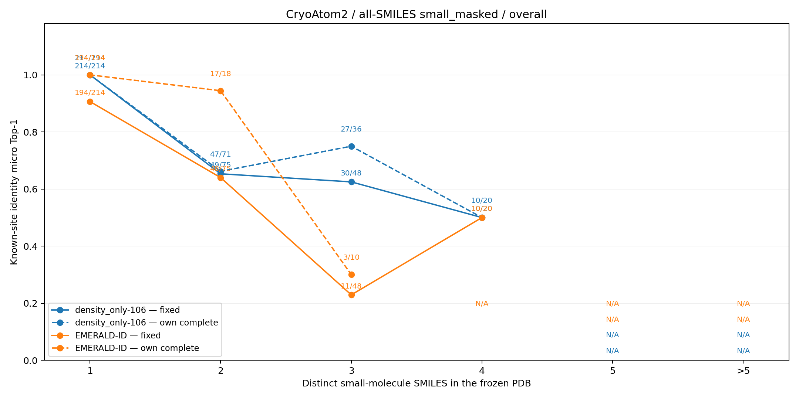
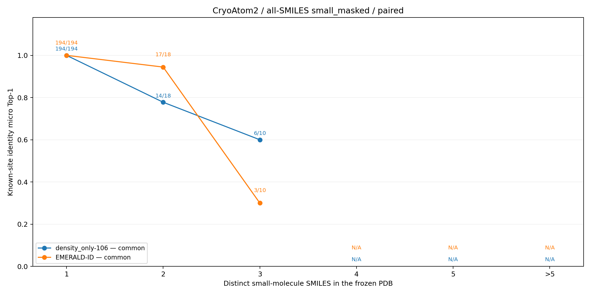

# 已知位点身份比较：nxu 固定查询点上的全部 SMILES 输入

本页只比较已经冻结的 **84 个 PDB、357 个小分子 occurrence 查询点**。每个查询点使用真实配体位置；真值是该 occurrence 的精确顶层 PreparedLigand.smiles。原小分子输入 Matcher 和官方 EMERALD-ID 的真实受体、CryoAtom2 正式逐点结果均直接复用。本轮没有重新截尾、训练或运行 EMERALD-ID，也没有启动全配体 NxU 测试。

## 输入、答案和分母

两个 Matcher 模型各有三种读出：

1. **小分子输入**：PDB 内只编码小分子精确 SMILES 集合；复用已有正式 nxu 预测。
2. **全部输入、不掩码**：PDB 内编码全部类别 occurrence 的精确 SMILES 去重集合，在全部可评分身份 logits 中取最大值。
3. **全部输入、小分子掩码**：读取上一步同一次完整身份前向产生的同一组 logits，仅在答案读取时屏蔽冻结类别非小分子的身份；不重新编码候选。

EMERALD-ID 始终只接收 PDB 内的小分子精确 SMILES 集合。因此本页的配对比较统一的是**查询点**，不是三种方法的输入候选范围。完整身份清单有 164 个按 PDB 计数的身份槽，原小分子身份清单有 114 个槽；84 个 PDB 内均不存在同一精确 SMILES 跨不同配体类别的情况。

“固定”分母始终为 357 点；准备、图或语言向量、官方评分失败的点不会删除，且没有正确预测时计为错误。“自身完整”对小分子输入 Matcher 要求该 PDB 全部小分子身份有图与语言向量；对全部输入的两种读出均要求该 PDB **全部类别身份**有图与语言向量；对 EMERALD-ID 要求该点全部小分子身份完成准备并取得有效官方评分。这三种可用条件不是同一种“解析成功”。“共同可用”在每个受体条件下，取七个模型/输入/读出组合各自完整条件的同一批冻结查询键交集。

## 真实受体：逐点 micro Top-1

| 方法与输入、读出 | 固定正确/357 | 固定准确率 | 自身完整正确/点数 | 自身完整准确率 | 共同可用正确/190 | 共同可用准确率 |
| --- | ---: | ---: | ---: | ---: | ---: | ---: |
| density_only-0；小分子输入 | 286/357 | 80.11% | 278/341 | 81.52% | 182/190 | 95.79% |
| density_only-0；全部输入、不掩码 | 259/357 | 72.55% | 253/341 | 74.19% | 166/190 | 87.37% |
| density_only-0；全部输入、小分子掩码 | 284/357 | 79.55% | 277/341 | 81.23% | 181/190 | 95.26% |
| density_only-106；小分子输入 | 301/357 | 84.31% | 296/341 | 86.80% | 181/190 | 95.26% |
| density_only-106；全部输入、不掩码 | 290/357 | 81.23% | 285/341 | 83.58% | 176/190 | 92.63% |
| density_only-106；全部输入、小分子掩码 | 301/357 | 84.31% | 296/341 | 86.80% | 181/190 | 95.26% |
| 官方 EMERALD-ID；小分子输入 | 233/357 | 65.27% | 182/190 | 95.79% | 182/190 | 95.79% |

本条件的 190 个共同可用查询点由原冻结键逐点相交得到，不是从结果中挑选答对的点。EMERALD-ID 的自身完整子集恰为这 190 点；这不表示它与 Matcher 使用了同一种身份准备机制。

## CryoAtom2：逐点 micro Top-1

| 方法与输入、读出 | 固定正确/357 | 固定准确率 | 自身完整正确/点数 | 自身完整准确率 | 共同可用正确/222 | 共同可用准确率 |
| --- | ---: | ---: | ---: | ---: | ---: | ---: |
| density_only-0；小分子输入 | 286/357 | 80.11% | 278/341 | 81.52% | 214/222 | 96.40% |
| density_only-0；全部输入、不掩码 | 259/357 | 72.55% | 253/341 | 74.19% | 194/222 | 87.39% |
| density_only-0；全部输入、小分子掩码 | 284/357 | 79.55% | 277/341 | 81.23% | 213/222 | 95.95% |
| density_only-106；小分子输入 | 303/357 | 84.87% | 298/341 | 87.39% | 214/222 | 96.40% |
| density_only-106；全部输入、不掩码 | 291/357 | 81.51% | 286/341 | 83.87% | 208/222 | 93.69% |
| density_only-106；全部输入、小分子掩码 | 303/357 | 84.87% | 298/341 | 87.39% | 214/222 | 96.40% |
| 官方 EMERALD-ID；小分子输入 | 263/357 | 73.67% | 214/222 | 96.40% | 214/222 | 96.40% |

density_only-0 的输入为原始实验密度，不读取受体数据。两条件的查询位置、密度、身份轴、训练 release 和 BEST 相同，所以其正式小分子输入和全部输入预测均复用真实受体结果；共同子集因 EMERALD-ID 的 CryoAtom2 官方评分覆盖不同而变化。density_only-106 则分别在两种受体条件下前向。

## 横轴分组与八张正式图

横轴只根据冻结清单计算每个 PDB 的**小分子精确 SMILES 去重数**，不随某方法是否成功评分而变化。组别 1、2、3、4 分别有 214、75、48、20 个固定查询点；组别 5 和 >5 没有查询点。真实受体共同子集在前四组的支持数为 163、17、10、0；CryoAtom2 为 194、18、10、0。空组标为 N/A，曲线不跨空组连接。

每个受体条件下，“全面比较”图各画 density_only-106 与 EMERALD-ID 的固定分母、各自完整分母，共四条曲线；“共同可用配对”图只画相同查询键上的两条曲线。颜色区别方法，线型区别分母，点旁为正确数/支持数。两个小分子掩码图中的 EMERALD-ID 是同一冻结基线，并非重新运行；density_only-0 和两模型小分子输入的完整数值保留在上表和机器可读汇总中。

### 真实受体

### CryoAtom2

可复核的逐方法正确数、分组支持数、各方法自身完整查询键和共同查询键见[真实受体汇总](nxu全部SMILES比较图片/real/summary.json)与[CryoAtom2 汇总](nxu全部SMILES比较图片/CryoAtom2/summary.json)。本页的图片和 JSON 已逐文件与服务器正式产物比较 SHA-256，一致。

## 有限解释与追溯

全部身份输入不掩码时，两个模型在固定 357 点上的正确数均低于各自小分子输入；只改变答案读取的小分子掩码使正确数大幅回升，但不保证和小分子输入逐点相同，因为完整身份轴还影响模型编码与库存交互。density_only-106 在两条件下的掩码正确总数恰与其小分子输入相同，**仅是总数相同**，不能据此断言逐点预测完全一致。

EMERALD-ID 的自身完整子集准确率很高，但真实受体只有 190/357、CryoAtom2 只有 222/357 点满足全部小分子身份的完整官方评分条件；固定分母结果必须与覆盖率同时阅读。横轴只有一个小分子身份时，小分子输入 Matcher、小分子掩码 Matcher，以及完整评分子集中的 EMERALD-ID 一旦能给出该身份，必然答对；这种 100% 是闭集单身份的定义性质，不是模型判别能力提升。106 通道和单通道模型的训练硬件等也不完全相同，本页不把性能差归因于单一输入维度。

正式输入快照、训练 BEST、GPU 门禁、三次模型前向、两次绘图、失败尝试和命令分类见[本任务日志](<../../test_真实场景(Structure)/执行记录/nxu全部SMILES输入.md>)；原小分子输入实验分别见[真实受体结果](nxu小分子真实测试.md)和[CryoAtom2 结果](nxu小分子CryoAtom2测试.md)。未读取 calibration，未在测试集拟合阈值。
