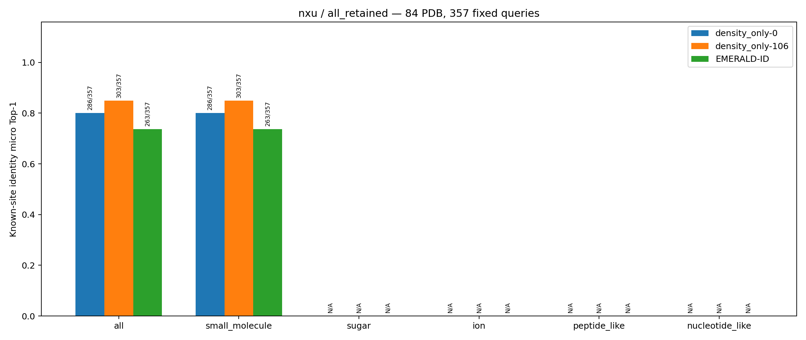
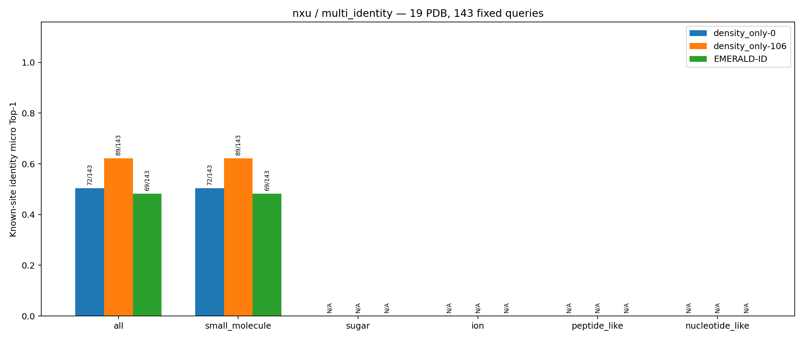

# 已知位点身份比较：nxu 小分子 CryoAtom2 受体条件

本页比较同一份冻结 nxu 清单上的三个方法。84 个 PDB、357 个真实小分子 occurrence 质心及每个 PDB 的精确顶层 PreparedLigand.smiles 候选集合，均与[真实受体条件](nxu小分子真实测试.md)相同。CryoAtom2 只替换受体条件：106 通道 Matcher 读取预测受体的模拟密度和原子特征，EMERALD-ID 对接使用预测受体的最终 mmCIF；原始实验密度及查询点不变。单通道 Matcher 的输入完全相同，经逐点核对后直接复用真实受体条件下的冻结预测，并未第二次前向。本测试只判断给定位置的身份，不检测配体是否存在。

## 逐点 micro Top-1 主结果

只有预测 SMILES 与该查询点原始顶层 SMILES 完全相同时才算正确。全部保留视图的分母为 357 点；多身份视图只筛选其中候选 SMILES 多于一个的 19 个 PDB、143 点，不改变候选集合或重新运行方法。没有准备成功身份或没有有效评分的点也在固定分母中，贡献 0 个正确。PDB 平均是先求每个 PDB 的点准确率，再对该视图中的 PDB 等权平均。

| 方法 | 全部保留：正确/357 | micro Top-1 | PDB 平均（84 PDB） | 多身份：正确/143 | micro Top-1 | PDB 平均（19 PDB） |
| --- | ---: | ---: | ---: | ---: | ---: | ---: |
| Matcher density_only-0，复用同输入预测 | 286/357 | 80.11% | 89.61% | 72/143 | 50.35% | 54.07% |
| Matcher density_only-106，CryoAtom2 前向 | 303/357 | 84.87% | 91.25% | 89/143 | 62.24% | 61.29% |
| 官方 EMERALD-ID，CryoAtom2 对接 | 263/357 | 73.67% | 82.69% | 69/143 | 48.25% | 49.80% |

全部 357 点均属于 small_molecule，因此该类别的正确数与支持数等于总体。sugar、ion、peptide_like、nucleotide_like 在本任务没有查询点，类别准确率未定义；图中的 N/A 不表示 0%。

## 有效评分覆盖

“有评分点”要求该点至少一个候选身份有有效分数；“全身份有评分点”要求该 PDB 的完整候选集合在该点全部有分数。“身份评分对”以每个查询点的原始候选身份数累计，未成功评分的候选仍计入总数。

| 方法 | 全部保留：有评分点/357 | 全身份有评分点/357 | 有评分身份对/588 | 多身份：有评分点/143 | 全身份有评分点/143 | 有评分身份对/374 |
| --- | ---: | ---: | ---: | ---: | ---: | ---: |
| density_only-0 | 357 | 341 | 572（97.28%） | 143 | 127 | 358（95.72%） |
| density_only-106 | 357 | 341 | 572（97.28%） | 143 | 127 | 358（95.72%） |
| EMERALD-ID | 313 | 222 | 397（67.52%） | 119 | 28 | 203（54.28%） |

EMERALD-ID 的 357 个正式逐点状态为：313 个 `scored`、42 个 `no_prepared_identity`、2 个 `no_valid_score`；多身份视图分别为 119、22、2。旧代码曾在 22 个预测受体查询点上因三字符链名而在 Rosetta 前失败。那些目录原样保存在实验 `attempts` 中，22 点已从同一冻结清单按原身份集合补跑；正式逐点根没有残留 `query_failed`，不能把旧输入格式错误当作科学评分失败。

## 与真实受体条件的有限对照

相同 357 点上，density_only-0 直接复用，因此两条件均为 286/357。density_only-106 从真实受体的 301/357 变为 CryoAtom2 条件的 303/357；EMERALD-ID 从 233/357 变为 263/357，且有评分点从 282 变为 313。多身份 143 点上，density_only-106 从 87 变为 89 个正确，EMERALD-ID 从 70 变为 69 个正确。这些是冻结运行的描述性差异；模型输入、受体结构和执行硬件并非都相同，不能把差异归因为单一因素。特别是 EMERALD-ID 的固定分母准确率包含身份准备和评分覆盖的变化，不能把它直接当作“成功评分时的纯身份区分能力”。

## 正式图与可复核数值

两张图直接复制自服务器正式汇总目录，未在本地重算或重绘。每组柱子表示固定查询点上的逐点身份 Top-1，柱顶标注正确数/支持数；all 与 small_molecule 重合是 nxu 的任务定义。

正式机器可读汇总为[全部保留视图](nxu小分子CryoAtom2测试图片/all_retained/summary.json)和[多身份视图](nxu小分子CryoAtom2测试图片/multi_identity/summary.json)。服务器原件位于 `/storage/penghongen/Matcher/evaluation/test_EMERALD-ID/CryoAtom2/summary/nxu/{all_retained,multi_identity}/`。清单、三方法逐点结果、训练快照、CPU/GPU release、launch、正式命令、门禁与补跑尝试分别见 [CryoAtom2 独立任务日志](<../../test_真实场景(Structure)/执行记录/CryoAtom2-nxu.md>)及[共享总日志](<../../test_真实场景(Structure)/执行记录/总日志.md>)。没有读取 calibration，也没有训练或在测试集拟合阈值。
