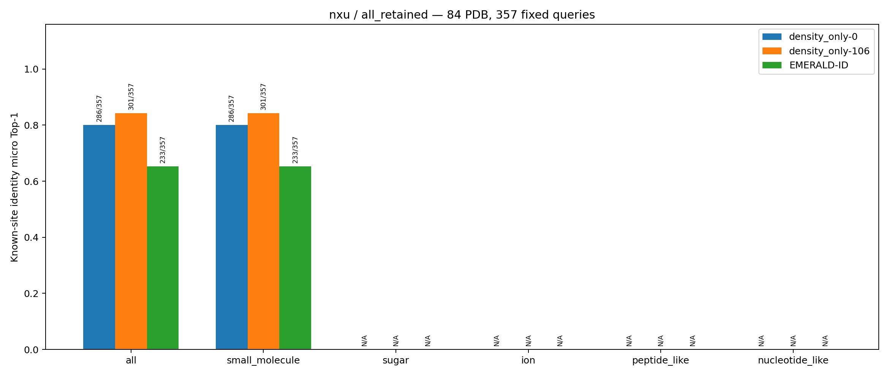
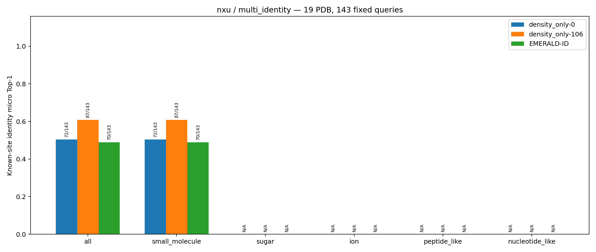

# 已知位点身份比较：nxu 小分子真实测试

本页只报告冻结的 nxu 小分子任务。查询点是测试集小分子 occurrence 的真实位置；每个 PDB 的候选身份是该 PDB 内小分子 occurrence 的精确顶层 PreparedLigand.smiles 去重集合。三种方法在同一查询点、同一候选集合上各给出一个身份；这不是检测配体是否存在的任务。正式清单从 94 个有查询点的 PDB 按“occurrence 数 × 身份数”截去成本最高的 10 个完整 PDB，保留 84 个 PDB、357 个查询点。多身份视图只是从这批预测中筛选出候选 SMILES 多于一个的 19 个 PDB、143 个点，不重新对接、前向或截尾。

## 逐点 micro Top-1 主结果

预测 SMILES 与查询点原始顶层 SMILES 完全相同才算正确。分母固定为清单内全部查询点；身份准备失败或没有有效评分也保留在分母中，计为不正确。PDB 平均先算每个 PDB 的点准确率，再对 PDB 等权平均，因此与逐点 micro 不同。

| 方法 | 全部保留：正确/357 | micro Top-1 | PDB 平均（84 PDB） | 多身份：正确/143 | micro Top-1 | PDB 平均（19 PDB） |
| --- | ---: | ---: | ---: | ---: | ---: | ---: |
| Matcher density_only-0 | 286/357 | 80.11% | 89.61% | 72/143 | 50.35% | 54.07% |
| Matcher density_only-106 | 301/357 | 84.31% | 91.18% | 87/143 | 60.84% | 61.03% |
| 官方 EMERALD-ID | 233/357 | 65.27% | 75.79% | 70/143 | 48.95% | 48.22% |

nxu 的全部查询点均属于 small_molecule，因此这一类别的正确数和支持数与各视图总体完全相同。sugar、ion、peptide_like、nucleotide_like 在本任务中没有查询点；其类别准确率未定义，图中显示 N/A，不应解释为 0%。全配体类别分层要等待独立的 NxU 任务。

## 有效评分覆盖与解释边界

“有评分查询点”表示至少一个候选身份得到有效评分；“全部身份有评分查询点”要求该点的 PDB 内所有候选身份均有评分。“身份评分对”按每个查询点的原始候选身份数累计，而不是仅数成功候选。两个 Matcher 变体使用相同身份资产，因此覆盖数相同；EMERALD-ID 的准备失败和无有效 Rosetta 分数分别作为失败记录保存。

| 方法 | 全部保留：有评分点/357 | 全身份有评分点/357 | 有评分身份对/588 | 多身份：有评分点/143 | 全身份有评分点/143 | 有评分身份对/374 |
| --- | ---: | ---: | ---: | ---: | ---: | ---: |
| density_only-0 | 357 | 341 | 572（97.28%） | 143 | 127 | 358（95.72%） |
| density_only-106 | 357 | 341 | 572（97.28%） | 143 | 127 | 358（95.72%） |
| EMERALD-ID | 282 | 190 | 365（62.07%） | 119 | 27 | 202（54.01%） |

EMERALD-ID 的 357 点逐点状态是：282 点有有效评分、42 点没有准备成功的身份、33 点运行后没有有效评分。它的固定分母准确率包含覆盖失败，不能仅凭本表把方法差距解释为“在全部候选均成功评分时的身份识别能力差距”。density_only-106 在全部保留点比 density_only-0 多正确 15 点；但两模型的体素输入不同，训练硬件也不同，这里是冻结模型的描述性比较，不是严格单变量因果消融。nxu 与 NxU 独立选 PDB，未来也不能直接把两者数值差解释为只改变候选身份范围。

## 正式图与可复核数值

以下两图直接复制自服务器正式汇总目录，未重新绘制。每组柱子表示三种方法在固定查询点上的逐点身份 Top-1；柱顶标注正确数/支持数。图中 all 与 small_molecule 在 nxu 任务重合是任务定义的结果。

两份可机器读取的正式汇总分别为 [全部保留 PDB](nxu小分子真实测试图片/all_retained/summary.json) 与 [多身份 PDB](nxu小分子真实测试图片/multi_identity/summary.json)。服务器原件位于 `/storage/penghongen/Matcher/evaluation/test_EMERALD-ID/summary/nxu/{all_retained,multi_identity}/`；它们由同一批冻结逐点预测派生。完整清单、三方法 release／launch、正式命令、失败尝试和图片 SHA-256 见 [共享总日志](<../../test_真实场景(Structure)/执行记录/总日志.md>)及其三个单实验日志。本轮没有读取 calibration，也没有训练 Matcher。
